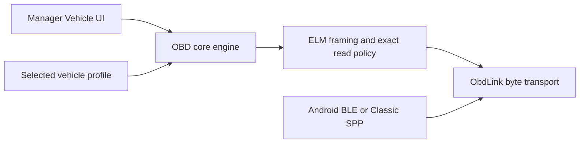

# Extending AVC Manager's OBD support

The OBD feature is split into an Android-independent engine, a Bluetooth transport module, compiled vehicle profiles and the Manager UI. Adding a car or a Bluetooth UART layout does not require editing the polling engine. This work prepares the code for reuse; it does not publish a repository or select a new project licence.



## Source boundaries

| Location | Responsibility | Dependencies |
| --- | --- | --- |
| `modules/obd-core` | Engine lifecycle, ECU discovery, framing, exact read policy, profiles, decoding, fault results, history and reconnect policy | Java8 APIs only; no Android, FYT, Manager UI, Bluetooth or network dependency |
| `modules/obd-android` | Android Bluetooth discovery, BLE UART selection, Classic SPP, GATT operations, deadlines and cancellation | Android API29+, OBD core |
| `app/.../VehiclePage.java` | Profile selection, saved adapter, dashboard configuration, category graphs, reports and permission UI | OBD core and Android transport |
| `ObdGaugeView` / `ObdHistoryView` | Native rendering of profile-supplied values and units | OBD core |

The standalone core can be used with another application or a different implementation of `ObdLink`. The bundled transport supports ELM-compatible BLE UART adapters and Bluetooth Classic SPP; this does not establish compatibility with every adapter brand or proprietary protocol.

## Included profiles and migration

- **Standard OBD-II** is the default for a new installation. It sends setup, standard discovery, declared advertised standard sensors and explicitly requested fault reads. It sends no manufacturer requests, physical header changes or unadvertised direct probes.
- **Toyota1GD · earlier130kW** contains the fixed earlier-1GD candidates used for this2018 Fortuner2.8 automatic. Enhanced probes require primary ECU7E8 on11-bit CAN. Toyota readings remain experimental until compared with an appropriate reference scanner.
- An existing installation's saved `obd_toyota_1gd` preference is migrated to `obd_vehicle_profile`. Existing CC3 configurations with a saved adapter and no explicit legacy flag retain their previous Toyota default. An explicit legacy false stays Standard. Unknown new profile IDs fall back to Standard.
- The saved adapter address/name/transport, Auto-connect preference, units, refresh target, dashboard count, styles and retained metric IDs are preserved. A metric absent from the new profile falls back to an available default. Changing profiles cancels the old connection and clears its support/readings/history; the UI requires a deliberate reconnect. The Auto-connect preference itself is not erased.

For the owner's Toyota profile, oil temperature,018B regeneration fields, service-regen status and inferred/unmapped regeneration counters have been removed. The misleading signed017A pressure comparison is also excluded from that profile. Other cars may still discover standard oil temperature and signed017A pressure when advertised. No Toyota-only formula is applied globally.

## Settings and monitoring

**Controls → Vehicle** contains the current profile, **Choose profile**, saved adapter, connection type, Auto-connect, scan and Connect/Disconnect/Pause/Resume controls. The main **Vehicle** page contains Dashboard, Sensors and Faults. Its status badge opens Vehicle settings directly. One engine and transport owner serve both views; this direct transition keeps the session running. Leaving both areas disconnects. Changing the profile clears old session data and requires reconnecting from Vehicle settings.

## Add a vehicle profile

1. Add a Java factory beside `profiles/GenericObdProfile.java` and `profiles/Toyota1gdProfile.java`. Return an immutable `ObdVehicleProfile` with a unique ID, user-facing name, applicability description and source attribution.
2. Reuse `StandardSensors.all()` entries as the same objects where appropriate. Add manufacturer-specific `ObdPid` definitions only for requests and formulas you have checked. Use namespaced IDs such as `yourmake.rail_pressure`; do not collide with another profile's differently defined sensor.
3. Each sensor declares service/identifier, minimum data length, units/range, minimum interval, decoder, optional physical request header/expected reply source, origin label, confidence and category. Enhanced addressing and experimental confidence are separate; the overload with an explicit experimental flag supports a reference-validated decoder without changing its addressing. `Decoder.decode` receives **only data bytes**: index0=A, index1=B, and so on. The core checks the positive response service/identifier and minimum length first. Throw an exception for absent fields or unknown enum states; never invent zero.
4. Service01 and21 identifiers are one byte; service22 identifiers are two bytes. Only these sensor-read services can be registered. Physical11-bit/29-bit CAN and six-hex-character legacy header values are explicitly validated; the engine uses only exact headers declared by the selected profile and restores that profile's functional header before standard/fault requests.
5. Put the expected primary ECU/protocol condition in the profile. Enhanced discovery requires that condition to match. `directProbeIds` is a small fixed probe set, not a PID sweep. The normal Standard profile's direct set is empty.
6. Optional `ObdCategory` entries supply a title, default primary sensor and help text. Sensors sharing that category automatically get one dashboard category with related graphs and an explicit **Use on card** action; the UI needs no new category-specific code.
7. Register the factory in `ObdProfiles.ALL`. The Vehicle profile picker, sensor list, dashboard choices, detail screens and exports use its definitions. Record source/definition changes; keep old IDs only when their meaning is preserved.
8. Add source-capture decoder tests and an independent fake-link session test. Cover short/malformed replies, other ECU replies, unsupported fields, units, cancellation, profile isolation and header restoration. Compare actual data with a reference tool before labelling the physical meaning/scale validated.

The core's command policy is built from the **selected profile**, not the union of registered cars. Merely compiling a Toyota profile does not authorize its commands on the Standard profile. The reply parser does no I/O; only a policy-checked engine query reaches `ObdLink.write`.

## Add a Bluetooth adapter layout

A vehicle profile and adapter transport are independent choices. BLE adapters expose a UART service with a write characteristic and a notify/indicate characteristic. Existing layouts live in `BleUartProfile.defaults()`; those three original mappings are unchanged for the saved VEEPEAK setup.

A fork can supply validated layouts without changing engine or vehicle code:

```java
List<BleUartProfile> layouts = new ArrayList<>(BleUartProfile.defaults());
layouts.add(new BleUartProfile("Validated adapter", serviceUuid, writeUuid, notifyUuid));
ObdBluetooth bluetooth = new ObdBluetooth(context, layouts, ObdBluetooth.DEFAULT_SPP_UUID);
```

The transport still checks service/characteristic UUIDs, write and notify properties, and CCCD presence before selecting a layout. Unknown writable characteristics are not tried. Classic uses the standard SPP UUID by default; the constructor can accept a verified alternative service UUID. Keep connection/GATT deadlines, serialized operations and `close()` cancellation when extending transport code.

For a different transport, implement `ObdLink`: worker-thread `open`, complete `write`, bounded `read` (0 timeout,−1 EOF), a description without private device identifiers, and a thread-safe `close` that unblocks open/read/write. Do not put ELM initialization or vehicle commands in the transport. Supply that link to `ObdEngine.connect`.

## Build and verify

From the repository root, with JDK21 configured:

```sh
JAVA_HOME=/path/to/jdk bash modules/obd-core/build.sh
JAVA_HOME=/path/to/jdk bash tools/test-obd-engine.sh
JAVA_HOME=/path/to/jdk ANDROID_JAR=/path/to/android.jar bash modules/obd-android/build.sh
```

The core JAR builds without an Android SDK. The app's existing `build.sh` includes both module source roots and retains the existing private signing key for upgrades. The core tests include a synthetic third vehicle with a two-byte service22 identifier and a different response ECU, proving that extension path without modifying the engine. These synthetic examples are not validated vehicle definitions.

New Android releases, additional adapter hardware, physical ECU support and firmware-specific Bluetooth behavior need their own acceptance. Native screenshot checks use the measured CC3 profile in `tools/cc3-display-profile.json`, independently of host protocol tests. Source credit for the Toyota candidates is in the profile and `research/toyota-1gd-custom-pids.md`; no full forum CSV or commercial table is bundled.

## Android consumer integration

The Bluetooth JAR does not request runtime permissions or bring its own Activity. A consumer declares the applicable Bluetooth/nearby-device and scan-location permissions for its Android/target-SDK combination, then supplies a Context after access is granted. The Manager's manifest and permission flow are the working API29 integration example. Discovery is foreground-only. The core JAR has no Android permission requirement. Both JARs include the existing project licence; the core also includes Toyota source attribution in META-INF/NOTICE. Local signing keys and device QA output remain under the ignored build directory.
