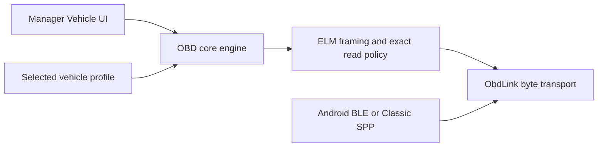

# Extending AVC Manager's OBD support

The OBD feature is split into an Android-independent engine, a Bluetooth transport module, compiled vehicle profiles and the Manager UI. A profile declares where it appears in the manufacturer, model and engine picker. Contributors can add cars and Bluetooth UART layouts independently of the polling engine.



## Source boundaries

| Location | Responsibility | Dependencies |
| --- | --- | --- |
| `modules/obd-core` | Engine lifecycle, ECU discovery, framing, exact read policy, profiles, decoding, fault results, history and reconnect policy | Java8 APIs only; no Android, FYT, Manager UI, Bluetooth or network dependency |
| `modules/obd-android` | Android Bluetooth discovery, BLE UART selection, Classic SPP, GATT operations, deadlines and cancellation | Android API29+, OBD core |
| `app/.../VehiclePage.java` | Profile selection, saved adapter, dashboard configuration, category graphs, reports and permission UI | OBD core and Android transport |
| `ObdGaugeView` / `ObdHistoryView` | Native rendering of profile-supplied values and units | OBD core |

The standalone core can be used with another application or a different implementation of `ObdLink`. The bundled transport supports ELM-compatible BLE UART adapters and Bluetooth Classic SPP; this does not establish compatibility with every adapter brand or proprietary protocol.

## Included profiles and migration

- **Standard OBD-II** is the default for a new installation. It sends setup, standard discovery, declared advertised standard sensors and explicitly requested fault reads. It sends no manufacturer requests, physical header changes or unadvertised direct probes.
- **Toyota → Fortuner, Hilux or Prado → 2.8 L diesel · 1GD-FTV · early 130 kW** offers the same engine definition for applicable early variants. It contains the fixed candidates used for the 2018 Fortuner 2.8 L automatic. Enhanced probes require primary ECU `7E8` on 11-bit CAN. Toyota readings remain experimental until compared with an appropriate reference scanner.
- An existing installation's saved `obd_toyota_1gd` preference is migrated to `obd_vehicle_profile`. Existing CC3 configurations with a saved adapter and no explicit legacy flag retain their previous Toyota default. An explicit legacy false stays Standard. Unknown new profile IDs fall back to Standard.
- The original profile ID is preserved. The chosen model is saved separately. If an upgrade finds a saved Toyota profile without a model, it shows the existing engine profile until the user chooses their model.
- The saved adapter address/name/transport, Auto-connect preference, units, refresh target, dashboard count, styles and retained metric IDs are preserved. A metric absent from the new profile falls back to an available default. Choosing a different vehicle cancels the old connection and clears its support, readings and history. Reconnect from Vehicle settings.

For the owner's Toyota profile, oil temperature,018B regeneration fields, service-regen status and inferred/unmapped regeneration counters have been removed. The misleading signed017A pressure comparison is also excluded from that profile. Other cars may still discover standard oil temperature and signed017A pressure when advertised. No Toyota-only formula is applied globally.

## Settings and monitoring

In **Controls → Vehicle → Choose profile**, choose a manufacturer, then the vehicle model, then the engine. The engine tap saves the choice. **Standard OBD-II** is available directly from the first screen for any car. **Sources** shows the evidence for the active profile. Browsing and going Back keep the current session active.

**Controls → Vehicle** also holds the saved adapter, connection type, Auto-connect and monitoring controls. The status badge on the main **Vehicle** page opens these settings while keeping the session running. Leaving both areas disconnects.

## Add a vehicle profile

1. Add a Java factory beside [Toyota1gdProfile.java](modules/obd-core/src/main/java/local/cc3/obd/profiles/Toyota1gdProfile.java). Give the profile a stable, unique ID, a short label for existing installations, an applicability description and source attribution.
2. Pass the manufacturer, engine display label and one or more model names as the final constructor arguments. Share a profile across models only when they use the same sensor definitions and ECU addressing. Use a separate profile ID and distinct engine option for variants that need different requests or decoding. Include year range, power output, market or transmission in the engine label when needed to tell variants apart. The picker groups names case-insensitively. Each manufacturer/model/engine path must be unique.
3. Register your factory in [`ObdProfiles.ALL`](modules/obd-core/src/main/java/local/cc3/obd/ObdProfiles.java), keeping Standard OBD-II first. Build the app and open **Controls → Vehicle → Choose profile** to check the new path. The dashboard, sensor list and report use the selected profile's definitions.

This example registers two fictional models under the same engine. It uses standard sensors as a starting point.

```java
package local.cc3.obd.profiles;

import java.util.Collections;
import local.cc3.obd.ObdVehicleProfile;

public final class ExampleProfile {
    public static ObdVehicleProfile create() {
        ObdVehicleProfile standard = GenericObdProfile.create();
        return new ObdVehicleProfile(
                "example-diesel-e20", "Example Motors E20",
                "Example 2.0 L diesel fitment.", "Standard OBD-II sensor definitions.",
                standard.sensors, standard.categories, Collections.emptyList(),
                "", "", "",
                "Example Motors", "2.0 L diesel · E20", "Model A", "Model B");
    }
}
```

Add `ExampleProfile.create()` to the list of factories and import its class in `ObdProfiles.java`. Replace the example fitment and source description with details for your own vehicle.

### Add manufacturer-specific sensors

- Reuse the existing standard sensor objects, as in the example. Give each custom `ObdPid` a namespaced ID such as `example.e20.rail_pressure`. Keep an ID stable while its meaning stays the same.
- Define the read service and identifier, required data length, units, range, minimum interval, decoder and origin. Include the physical request header and expected response ECU where needed. Services `01` and `21` use one-byte identifiers, and `22` uses two. `Decoder.decode` receives the data bytes starting with A at index 0. Throw on missing fields or unknown enum values so the app can distinguish unavailable data from a real zero.
- Specify the matching primary ECU and protocol in the profile. Keep `directProbeIds` to a small set of known reads. The engine uses the selected profile's exact read commands and restores the declared functional header for standard and fault requests.
- Use an `ObdCategory` when readings belong together. It defines a default card metric and related graphs. The user can change the primary reading with **Use on card**.
- Add decoder tests using captured replies and a fake-link session test. Cover short replies, unexpected reply ECUs, unsupported readings, units and header restoration. Compare values with a reference scanner before marking a definition validated.

The core's command policy is built from the **selected profile**, not the union of registered cars. Merely compiling a Toyota profile does not authorize its commands on the Standard profile. The reply parser does no I/O; only a policy-checked engine query reaches `ObdLink.write`.

## Add a Bluetooth adapter layout

A vehicle profile and adapter transport are independent choices. BLE adapters expose a UART service with a write characteristic and a notify/indicate characteristic. Existing layouts live in `BleUartProfile.defaults()`; those three original mappings are unchanged for the saved VEEPEAK setup.

A fork can supply validated layouts without changing engine or vehicle code:

```java
List<BleUartProfile> layouts = new ArrayList<>(BleUartProfile.defaults());
layouts.add(new BleUartProfile("Validated adapter", serviceUuid, writeUuid, notifyUuid));
ObdBluetooth bluetooth = new ObdBluetooth(context, layouts, ObdBluetooth.DEFAULT_SPP_UUID);
```

The transport still checks service/characteristic UUIDs, write and notify properties, and CCCD presence before selecting a layout. Unknown writable characteristics are not tried. Classic uses the standard SPP UUID by default; the constructor can accept a verified alternative service UUID. Keep connection/GATT deadlines, serialized operations and `close()` cancellation when extending transport code.

For a different transport, implement `ObdLink`: worker-thread `open`, complete `write`, bounded `read` (0 timeout,−1 EOF), a description without private device identifiers, and a thread-safe `close` that unblocks open/read/write. Do not put ELM initialization or vehicle commands in the transport. Supply that link to `ObdEngine.connect`.

## Build and verify

From the repository root, with JDK21 configured:

```sh
JAVA_HOME=/path/to/jdk bash modules/obd-core/build.sh
JAVA_HOME=/path/to/jdk bash tools/test-obd-engine.sh
JAVA_HOME=/path/to/jdk ANDROID_JAR=/path/to/android.jar bash modules/obd-android/build.sh
```

The core JAR builds without an Android SDK. The app's existing `build.sh` includes both module source roots and retains the existing private signing key for upgrades. The core tests include a synthetic third vehicle with a two-byte service22 identifier and a different response ECU, proving that extension path without modifying the engine. These synthetic examples are not validated vehicle definitions.

New Android releases, additional adapter hardware, physical ECU support and firmware-specific Bluetooth behavior need their own acceptance. Native screenshot checks use the measured CC3 profile in `tools/cc3-display-profile.json`, independently of host protocol tests. Source credit for the Toyota candidates is in the profile and `research/toyota-1gd-custom-pids.md`; no full forum CSV or commercial table is bundled.

## Android consumer integration

The Bluetooth JAR does not request runtime permissions or bring its own Activity. A consumer declares the applicable Bluetooth/nearby-device and scan-location permissions for its Android/target-SDK combination, then supplies a Context after access is granted. The Manager's manifest and permission flow are the working API29 integration example. Discovery is foreground-only. The core JAR has no Android permission requirement. Both JARs include the existing project licence; the core also includes Toyota source attribution in META-INF/NOTICE. Local signing keys and device QA output remain under the ignored build directory.
