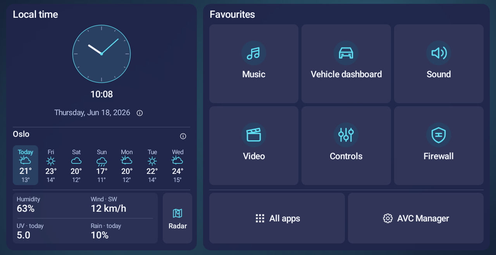

# AVC Manager

**Android Vehicle Console** is a Home launcher and management app for TEYES CC3 and compatible FYT 6315 head units running Android 10. It includes a configurable Home screen, local media playback, a per-app firewall and read-only OBD-II monitoring. The APK targets arm64-v8a. Manager uses a right-side navigation rail on wide displays and top tabs on smaller displays.

[](docs/screenshots/README.md)

[View the screenshot gallery](docs/screenshots/README.md)

Version **0.5.19** (build 62) adds manufacturer, model and engine selection under **Controls → Vehicle → Choose profile**. In **Choose Home shortcuts**, tap **N selected** to see your apps, AVC functions and vehicle readings together.

## Features

- **Wireless** groups mobile data, Wi-Fi, and Wi-Fi debugging. Owner-activated debugging expires after 15 minutes or a change/loss of the approved Wi-Fi connection; an authentication challenge is required before its managed status is shown. Legacy ADB remains unencrypted, and Android force-stop can prevent the guard/alarm from running. Turn it off when finished. On devices with telephony, the themed mobile pages show the carrier, data status, and active APN. Mobile data switching uses authenticated local ADB, usage totals require Android usage access, and APN edits open Android's editor.
- **Firewall** enforces saved IP and app rules. **Protection** adds opt-in restart/reboot/update persistence for rule enforcement and an explicit unidentified-public-traffic policy. Android always-on/lockdown setup is available separately; it is never enabled automatically. Capture stays manually controlled. **Traffic capture** independently records connection metadata for the list and map. Both use the same local VPN. Tap a connection to inspect it, block its IP, or block the app if Android provides a unique package identity. Open **Block rules** to remove rules or add an IP directly.
- **Firewall → Map** looks up approximate destination countries offline. Pinch or double-tap to zoom, and drag to move. Choose a country to focus the map, then tap its marker or **Destination IPs** to inspect and block individual addresses. Use **Locate an IP** for a manual lookup. **IP details → Look up** sends only the selected address to the configured DNS resolver and the network registry for reverse DNS and RDAP registration details.
- **Dashboard** provides six fixed Home layouts with 64 dp app icons. At the recorded CC3 display profile, Home fits without horizontal or vertical scrolling. Every layout has a permanent **All apps** control that opens a searchable drawer of all installed launchable apps, independently of the chosen favourites. The drawer can scroll through long app lists.
- **Appearance** shows the layout cards and four settings entries: **App colours**, **Background**, **Clock & tiles**, and **Sidebar**. Sidebar switches Words/Icons immediately and independently of Home layout. Its fixed action bar keeps **Apply to Home**, **Full-screen preview**, and **Choose Home shortcuts** visible. Preview uses the Home renderer; App colours update Manager and AVC Home immediately. Apply saves the layout, background, clock face, tile count and panel-heading choice together. The gallery has nine choices, including **Your photo** and **Solid colour**. Clock & Favourites supports four or six tiles and Digital, Analogue, Split and Stacked clock faces. [Dashboard guide](DASHBOARD.md)
- **Controls → Voice** shows the configured Android assistant and speech recognition provider. Open Android's default assistant settings, launch Google Assistant if installed, or run a short voice input test. The test transcript is displayed for the current screen. Hanna's separate TEYES voice commands can be enabled or disabled through authenticated local ADB.
- **Controls → Display settings** adjusts the saved TEYES day and night backlight presets on supported FYT firmware.
- **Entertainment** plays audio/video saved on the CC3, with search, folder filtering, seek, queue controls and background music. **Upload** shows the local browser address and a temporary pairing code for adding files from a laptop; mobile data is not required. The upload service is off by default and time limited. HTTPS uses a per-device AndroidKeyStore identity; verify the certificate fingerprint on the CC3 or use the pinned Python uploader before pairing. [Guide and formats](ENTERTAINMENT.md)
- **Controls → Home app** lists other installed Home apps with friendly names and opens Android Home settings when you choose to change the default launcher.
- **Controls → Weather** enables or disables the seven-day forecast beneath Clock & Favourites. Choose a saved city/postcode without location permission, or opt into automatic device location with a saved-place fallback. Weather starts off. Open-Meteo receives forecast coordinates; device coordinates are rounded to about one kilometre and require separate weather consent. A configured forecast refreshes on first startup and retries promptly when the network returns. After success it refreshes hourly while visible. Cached forecasts appear during loading; data older than 24 hours is hidden. Update age and provider credits are in the top-right info panel. Humidity and wind are current conditions; UV and rain chance are today’s forecast maxima. Location and updates stop when the forecast leaves the foreground. [Weather design and sources](research/weather-options.md)
- **Home weather → Map** opens the original Windy embed after a separate first-use opt-in. It reuses the weather location without another Open-Meteo forecast request. Radar is observed rain; Forecast is modelled rainfall with Windy’s own timeline. Public distribution of the native Windy integration is pending clarification. The viewer stops and is destroyed when it leaves the foreground. [Map controls, privacy and prototype limits](WEATHER_MAP.md)
- **Vehicle** has four/six/nine configurable cards, units, a saved refresh target and ten rolling one-minute averages. **Controls → Vehicle** holds Connect/Disconnect, Pause/Resume, the saved default’s Auto-connect option and **Choose profile**. Browse by manufacturer, model and engine, or select **Standard OBD-II** directly. The monitoring status badge links directly to these settings, preserving the connection; leaving both vehicle areas stops polling. DPF, Fuel rail and Injectors are single dashboard categories; tap one to browse related graphs and choose **Use on card** for its primary stat. Only complete responding enhanced fields become available. The Toyota profile excludes oil-temperature and regeneration fields; other cars can discover standard oil temperature if advertised. A new install defaults to Standard OBD-II; existing Toyota settings migrate without resetting the adapter or dashboard. No code clearing, actuation or programming is included. [Add a vehicle profile](OBD_MODULES.md#add-a-vehicle-profile) · [Toyota research](research/toyota-1gd-custom-pids.md)

- **Sound** displays the 27-band Equalizer and runs presets on the CC3 DSP. **Speaker position** controls left/right balance and front/rear fader live in Easy Sound Field mode. If the DSP uses Advanced mode, the panel offers **Enable Easy mode**, which can replace manually configured speaker levels. **Bass & treble** adjusts the low and high bands live in a −4 to +4 dB range relative to the current curve. **Reset tone** removes those adjustments immediately. **Techno** previews a custom gain curve. **Restore previous** returns to the preset that was active before the change. Custom preview edits require the DSP to report support for unsaved preset edits. **Play test track** uses media access to play the CC3's local copy of Imagine Dragons' **Believer (Live Acoustic)**. If the file is missing, it plays the built-in instrumental. On supported TEYES DSP firmware, the app temporarily switches FM to media and restores FM when playback ends.

## Firewall scope

The local VPN forwards supported TCP, UDP, and ICMP traffic on public routes through the device's current network. The local network, local resolvers, and Wi-Fi ADB can continue to operate outside the tunnel. Android routes a single active VPN for each user. Android and TEYES services with a shared UID appear as a group and support destination rules. A rule survives an app restart and applies when the firewall is on. Start each feature manually. Capture keeps recent connection metadata in memory and does not save packet contents. A country result is an estimate for the IP allocation.

## Display and validation profile

The measured reference device is a 1280 × 720 CC3 at 160 dpi with Android text scale **1.5×**. Its TEYES bar occupies the top 60 pixels, leaving app bounds **(0, 60)–(1280, 720)**, or 1280 × 660 usable pixels, with no bottom system bar. [Recorded profile](tools/cc3-display-profile.json)

## Build

Set `ANDROID_JAR`, `BUILD_TOOLS`, `JAVA_HOME`, and `ANDROID_NDK_HOME`. Release builds also require an existing `CC3_SIGNING_KEY` and a private `CC3_SIGNING_PASSWORD_FILE`, both outside the checkout and mode 0600. Run `bash tools/verify.sh` for host/security tests, warning-gated Java compilation, vendored source lock/SBOM, native analysis, local Semgrep checks, signed build and APK hardening checks. Install Semgrep 1.136.0 or set `SEMGREP_BIN` to its executable.

With the toolchain paths set, run the development checks with the following command.

```sh
CC3_BUILD_MODE=debug bash tools/verify.sh
```

Use Android platform 35, Build Tools 35.0.0, JDK 21 and NDK r27d. The original signing certificate is retained for upgrades. `CC3_BUILD_MODE=debug` explicitly creates a separate development identity; that build cannot upgrade the owner's release-signed installation. Release builds fail if the key is absent instead of silently generating another identity. CI uses only the development mode and immutable Action commits. [Security/build guide](SECURITY_HARDENING.md).

## Licence

AVC Manager's original code, tools and documentation use the GNU Affero General Public License, version 3 only (`AGPL-3.0-only`). The inherited FYT/ADB code, the zdtun library and the bundled artwork and data retain their respective terms. [Project licence](LICENSE) · [Copyright and third-party notices](NOTICE)

## Third-party material

- Eight original Pixabay background images are bundled under CC0. Sources, authors and publication dates are recorded in `app/src/main/assets/wallpapers/credits.html`.
- Three NASA-credited photographs come from NASA's [desktop wallpaper collection](https://www.nasa.gov/international-space-station/desktop-and-mobile-wallpapers/). Source and usage links are recorded in `app/src/main/assets/wallpapers/nasa-credits.json`. NASA endorsement is not implied.
- Contour and Aurora glow are original artwork rendered locally by AVC Manager. **Appearance → Background → Image credits** shows the bundled image credits. **Your photo** uses an image selected through Android's file picker; its licence remains the owner's responsibility.

- zdtun at [commit 4a53fbb](https://github.com/emanuele-f/zdtun/tree/4a53fbbbfc16ed012af676a871dd989f3583a5e6) is included as a separate shared library under LGPL 3.0 or later. [Corresponding source and license](third_party/zdtun/). The local patch lets the socket-open callback reject forwarding if Android refuses to protect a socket from the VPN.
- IP geolocation by [DB-IP](https://db-ip.com/db/download/ip-to-country-lite), November 2026 Country Lite, [CC BY 4.0](https://creativecommons.org/licenses/by/4.0/). The packed asset sorts the source ranges and omits unknown country records. Original uncompressed CSV SHA-1 `e2061015c43ec91c94a12191a6a613279eb94c0c`.
- Map boundaries made with [Natural Earth](https://www.naturalearthdata.com/about/terms-of-use/), release 5.1.2, public domain. Coordinates are rounded and polygon interiors are omitted.
- Regenerate both map assets with `python3 tools/pack-geodata.py country.csv.gz countries.geojson app/src/main/assets`.

Toyota candidate definitions cite their original authors in `app/src/main/assets/obd-toyota-notice.txt` and **Controls → Vehicle → Choose profile → Sources**. The removed oil-temperature decoder's historical OBDb/CC BY-SA 4.0 attribution is retained in the notice.

## OBD research

[Monitoring research](research/obd-monitoring.md) and the [integration proposal](research/obd-integration.md) describe the Veepeak/2018 Fortuner scope. The physical VEEPEAK/CC3 connection and ECU monitoring were verified in 0.3.2. The optional Toyota1GD read-only profile was verified communicating with this ECU in 0.3.4; its custom values remain labelled Toyota test pending reference-tool validation. [2018 1GD automatic research and source register](research/toyota-1gd-custom-pids.md)
