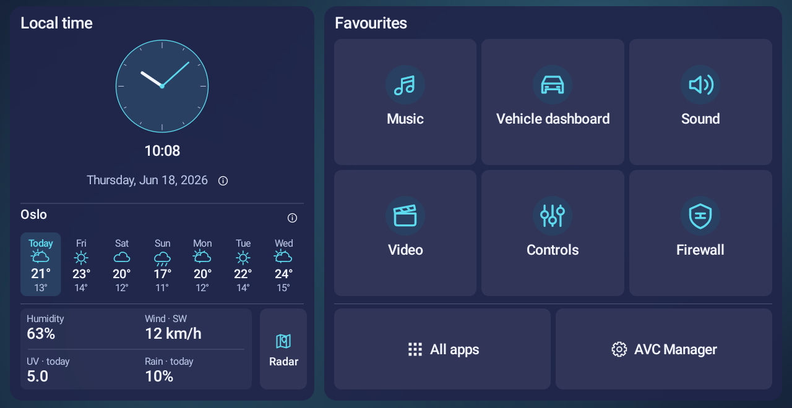
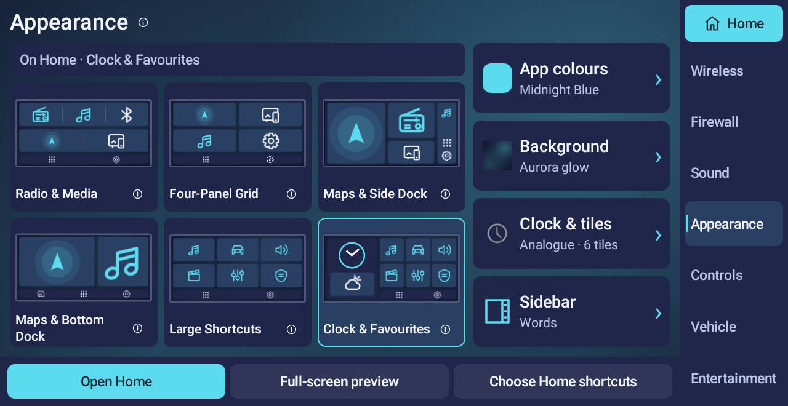
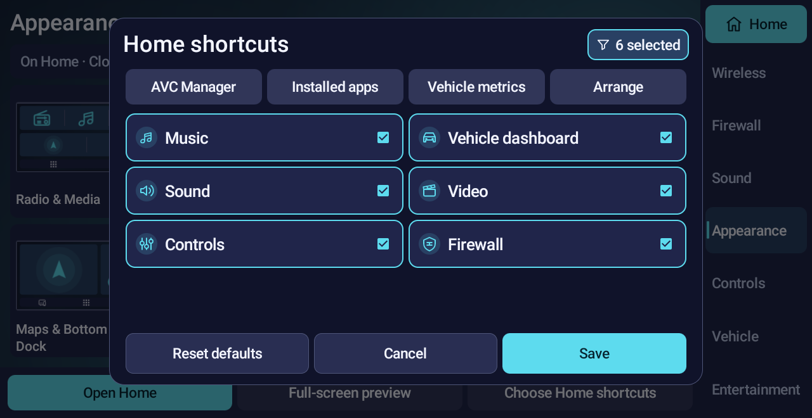
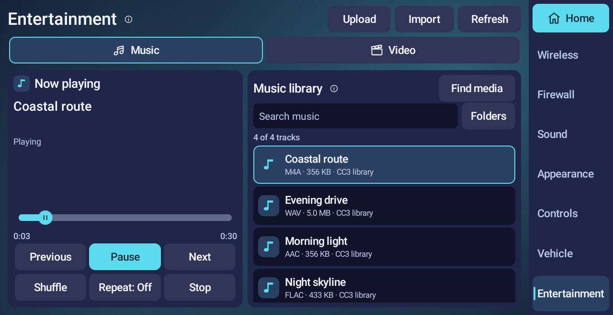
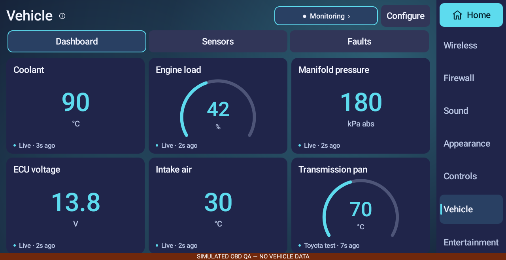
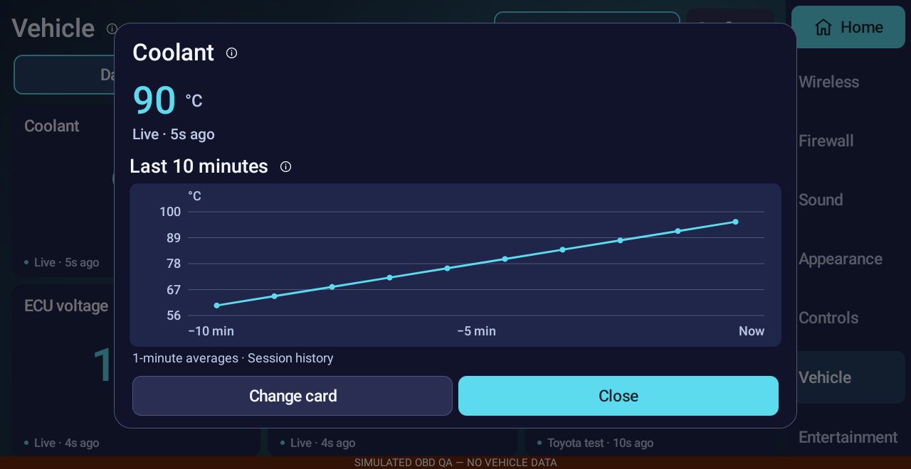

# AVC Manager screenshots

These screens are from AVC Manager 0.5.18 on an Android 10 emulator configured for a 1280 × 720 head unit. Each PNG shows the 1280 × 660 app area. The forecast, media library and OBD readings use sample data.

## Home

An analogue clock, seven-day example forecast for Oslo and six configurable shortcuts share the Home screen.

## Appearance

Preview six Home layouts and choose the app colours, background, clock and sidebar.

## Selected shortcuts

Tap the count in the top right to see the current selection in Home order. Tap a checked shortcut to remove it from the draft.

## Entertainment

The local player shows the current track, playback controls and offline music library.

## Vehicle dashboard

Number and dial tiles display data from a simulated OBD adapter.

## Sensor history

Selecting a reading opens its ten-minute history. Each point on the graph is a one-minute average.

